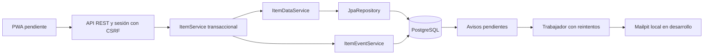
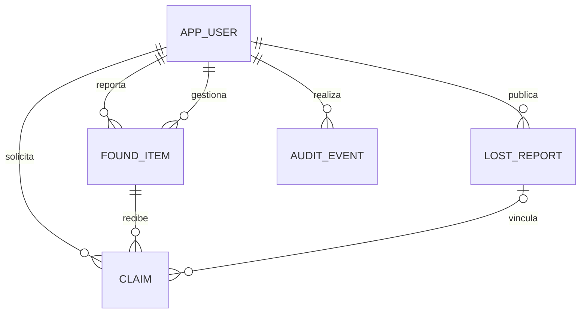

# Arquitectura inicial

Un proceso Spring Boot y una base PostgreSQL. La PWA será cliente de la API bajo el mismo origen. Java 21. No se implementó interfaz gráfica en este incremento.

`email_outbox` guarda destinatario y evento único del hallazgo; el cierre y la inserción del evento son atómicos. La entrega SMTP local se implementa con Mailpit en el perfil dev; la integración institucional está pendiente.

## Estados

- Hallazgo: AVAILABLE → RETURNED.
- Resguardo: WITH_FINDER → OFFICE; independiente del estado del hallazgo. Al devolver se conserva el último lugar de resguardo para historial, no indica posesión actual.
- Reclamo: PENDING → ACCEPTED → COMPLETED; PENDING → REJECTED; PENDING/ACCEPTED → CANCELLED; otros PENDING → CLOSED al recuperar el objeto.
- Extravío: ACTIVE → RECOVERED, mediante reclamo vinculado o confirmación de recuperación externa.

## Integridad y privacidad

Las operaciones sobre reclamos bloquean el hallazgo antes de modificarlo. Los índices parciales impiden reclamos activos duplicados y más de un ganador por hallazgo. Las evidencias textuales y correos de contacto solo se devuelven al solicitante y responsable actual; el catálogo expone descripción pública e IDs, no correos.

Se usa UUID como identificador visible provisional. Folios institucionales consecutivos todavía no están implementados. La oficina del edificio I se representa por un valor de resguardo, sin crear una infraestructura de casetas que no existe en el proceso real.

## Decisiones pendientes

- Confirmar política de delegación: implementada inmediata hacia personal habilitado, sin confirmación del destinatario.
- Directorio de personal y administración de cuentas: no hay autoasignación de roles.
- DTOs, repositorios JPA, entidades, controladores y servicios están separados por capas siguiendo los ejemplos de Alfonso. ItemService conserva la frontera transaccional; una partición adicional por dominio puede hacerse cuando crezca el MVP.
