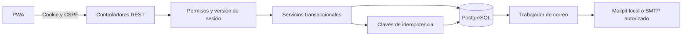

# Módulo 6: contrato, integración y despliegue

## Contrato de la API

`GET /api/v1/openapi.json` entrega OpenAPI 3.0.3 sin iniciar sesión: 38 rutas y 49 operaciones. También puedes importar `src/main/resources/openapi.json` directamente en Postman. No incluye Swagger UI. El contrato cubre autenticación, cuentas, catálogos, publicaciones, fotos, directorio y reclamos. Las reglas detalladas de permisos siguen documentadas en las guías de cada módulo.

`GET /api/v1/health` comprueba API y PostgreSQL: 200 `{"status":"UP"}` o 503 `{"status":"DOWN"}`, sin exponer credenciales ni detalles internos. No comprueba entrega SMTP ni sustituye la monitorización del proveedor.

Para actualizar el contrato después de modificar DTOs o rutas:

```bash
python3 scripts/generate-openapi.py
```

El generador extrae los tipos de los records y enums; las rutas y restricciones específicas se mantienen explícitamente en el script. Las pruebas Java verifican que todos los controladores tengan representación en el contrato. Esto no sustituye actualizar ejemplos y permisos cuando cambian las reglas de negocio.

## Conectar el frontend

El frontend existente todavía requiere adaptación a este contrato; este módulo no modifica su repositorio ni verifica sus pantallas reales. Usa [frontend-client.mjs](frontend-client.mjs) como ejemplo de fetch con cookies, CSRF, errores y FormData.

- API base local: `http://localhost:8080/api/v1`.
- La sesión usa cookies: `credentials: 'include'`. No usa Bearer Token ni almacenamiento de tokens de acceso en localStorage.
- Obtén `/auth/csrf` y envía el header cuyo nombre devuelve la respuesta en cada POST/PUT/DELETE. Renueva CSRF después de login.
- Los errores 401 requieren iniciar sesión; un 403 puede indicar CSRF vencido o falta de permiso. El cliente de ejemplo no reintenta escrituras automáticamente.
- Los catálogos y `/claims/search` devuelven `items` y `total`; `/claims` conserva su array anterior. `page` empieza en 0.
- Traduce etiquetas de la interfaz a enums del contrato: no envíes textos como “Electrónica” en lugar de ELECTRONICS.
- Para fotografías usa FormData con `file` y permite que el navegador añada Content-Type y boundary.

### CORS

Para un frontend local en otro puerto del mismo host, añade a tu `.env` local y reinicia:

```bash
CORS_ALLOWED_ORIGINS='http://localhost:5173'
```

Permite varios orígenes exactos separados por comas. No admite comodines, rutas ni barra final. Por defecto la lista está vacía: las peticiones del mismo origen funcionan, pero otros orígenes no están autorizados. CORS permite credenciales y los headers Content-Type, X-CSRF-TOKEN e Idempotency-Key; no reemplaza autenticación ni CSRF.

Usa el mismo nombre de host para frontend y API: no mezcles localhost con 127.0.0.1. Las cookies siguen con SameSite=Strict; autorizar CORS no las convierte en cookies entre sitios diferentes. Para producción, sirve la PWA y `/api/` bajo el mismo origen HTTPS mediante un proxy. No se ha cambiado SameSite ni desactivado CSRF.

### Reintentos de creación

Los siguientes POST aceptan el header opcional `Idempotency-Key`:

- `/found-items`
- `/lost-reports`
- `/found-items/{id}/claims`

Genera una clave nueva por intención de creación (por ejemplo `crypto.randomUUID()`), y conserva esa misma clave y los mismos datos si reintentas porque se cortó la conexión. Ejemplo:

```js
const key = crypto.randomUUID();
await api.createFound(datosDelFormulario, key);
// Si se desconoce el resultado por una falla de red, reintentar con key y datos idénticos.
```

La clave admite 8..100 caracteres: letras ASCII, números, punto, guion, guion bajo y dos puntos. Repetir clave, usuario y operación con los mismos campos deserializados devuelve 201 y el mismo ID, incluso si el recurso cambió de estado después. Cambiar los datos con esa clave devuelve 409. Otra cuenta u otra operación tiene un ámbito independiente. Los espacios dentro de los campos cuentan; el orden de las propiedades JSON no cuenta. Los campos desconocidos siguen la política de deserialización existente y no forman parte de la huella.

Un error de negocio no consume la clave. El recurso, auditoría y registro de idempotencia se confirman en una misma transacción. PostgreSQL serializa los intentos simultáneos mediante un bloqueo asesor transaccional. V6 agrega `creation_request`; las claves persistidas se conservan y no expiran automáticamente. La política de retención de estas filas queda para operación; borrar una clave elimina su garantía histórica de reintento.

Sin clave se conserva el comportamiento anterior. No se aplica esta protección a cargas de fotografías ni a todas las acciones de la API. Consulta antes de repetir una carga cuyo resultado se desconozca. Office, retiro y confirmación final tienen las reglas de repetición de los módulos anteriores; no asumas idempotencia universal.

## Arquitectura



## Despliegue preparado

El Dockerfile empaqueta el JAR construido con Java 21 y ejecuta como usuario 10001. `compose.production.yaml` usa PostgreSQL con volumen independiente, API con raíz de solo lectura y `/tmp` temporal, y publica la API únicamente en loopback. No activa dev, cuentas demo, Mailpit ni SMTP remoto. No publica PostgreSQL en el host.

Este archivo es una base de despliegue para una sola instancia. No se ha publicado ningún servicio en Internet, creado un dominio ni configurado certificados. El límite de intentos y las sesiones siguen siendo locales a la instancia; las sesiones se pierden al reiniciar.

Pasos desde la carpeta del proyecto:

1. Ejecuta las pruebas contra una base temporal; construye el JAR con `mvn verify`. El perfil de pruebas necesita TEST_DB_URL, TEST_DB_USER y TEST_DB_PASSWORD (por defecto usuario caza_test y contraseña vacía).
2. Crea un archivo privado `.env.production` con una contraseña nueva para `DB_PASSWORD` y, si lo necesitas, `API_PORT`. No uses credenciales demo. `chmod 600 .env.production`.
3. Construye e inicia con un nombre de proyecto independiente:

```bash
docker compose --env-file .env.production -p caza-prod -f compose.production.yaml config --quiet
docker compose --env-file .env.production -p caza-prod -f compose.production.yaml up -d --build
curl --fail http://127.0.0.1:8080/api/v1/health
```

4. Configura tu proxy HTTPS para enviar `/api/` al puerto local, conservando la ruta. La PWA debe usar ese mismo origen. Las cookies son Secure: el login no funciona de forma completa sobre HTTP externo.
5. El perfil de producción sin SMTP acumula correos en outbox. Para habilitar correo real se necesita un override de Compose que pase SPRING_PROFILES_ACTIVE=smtp y las variables SMTP del [módulo 5](passwords-and-roles.md), más un proveedor autorizado y una prueba real de entrega. No reutilices la base de datos ficticia para enviar correo real.

Para actualizaciones, respalda antes la base y construye otro JAR/imagen. Flyway aplica migraciones al iniciar; volver a una imagen anterior no revierte esas migraciones. El Dockerfile usa una etiqueta de Java 21: registra el digest de la imagen de cada entrega si necesitas reproducir exactamente la base utilizada.

### Respaldo y restauración

Desde el mismo proyecto de Compose:

```bash
umask 077
docker compose --env-file .env.production -p caza-prod -f compose.production.yaml exec -T db \
  pg_dump -U cazaobjetos -d cazaobjetos -Fc > cazaobjetos-backup.dump
```

El respaldo incluye fotos, outbox y tokens/códigos protegidos: mantenlo privado. Comprueba la restauración en una base nueva aislada usando `pg_restore --exit-on-error --no-owner`, nunca sobrescribiendo la base activa para probar. Conserva también la configuración de despliegue y secretos por separado. No ejecutes `down -v` para actualizar: eliminaría el volumen.

## Verificación

Importa `postman/Integracion.postman_collection.json` con el entorno Local. Sus 45 peticiones comprueban el flujo original y reintentos de hallazgo, extravío y reclamo, además de salud y contrato. Crean datos ficticios; no vacían la base.

Fuentes técnicas: [CORS en Spring Security](https://docs.spring.io/spring-security/reference/servlet/integrations/cors.html) y [OpenAPI 3.0.3](https://spec.openapis.org/oas/v3.0.3.html).

Verificado el 10 de noviembre de 2026: 63 pruebas Java sin fallos, validación OpenAPI 3.0.3 y cobertura de rutas de controladores, sintaxis del cliente JavaScript, construcción de imagen Docker, validación de Compose y 45 peticiones/55 assertions de Postman contra el contenedor. El contenedor se probó como usuario 10001 con raíz de solo lectura. La configuración HTTPS, la entrega SMTP real y las pantallas del repositorio frontend requieren verificación en su entorno definitivo.
